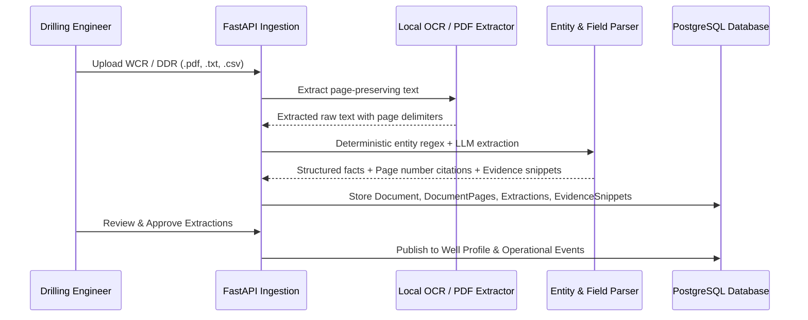
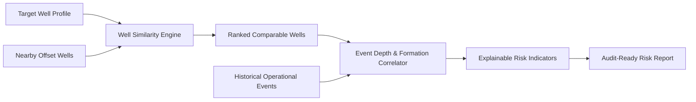
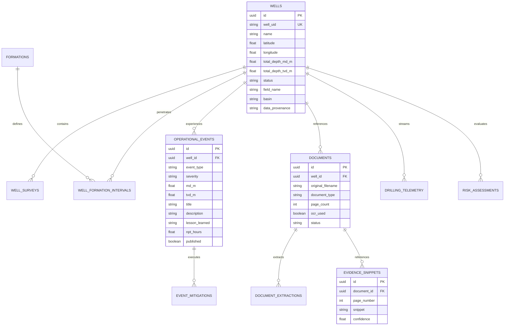

# TrustDrill System Architecture

> **Smart India Hackathon (SIH 26121)** — AI-Powered Nearby Offset Wells Intelligence System (eRTMAC-NWIS)

---

## 1. High-Level Architecture

TrustDrill integrates geospatial offset well analysis, automated drilling report document intelligence, transparent multi-factor correlation, and explainable hazard intelligence into an audit-ready platform for drilling engineers.

```mermaid
flowchart TD
    subgraph UI ["Frontend (Next.js 14 / TypeScript / Tailwind / Leaflet)"]
        Dashboard["Operations Dashboard"]
        GIS["GIS Offset Well Explorer"]
        DocReview["Document Review & OCR Viewer"]
        CorrelationUI["Multi-Well Correlation Matrix"]
        RiskUI["Explainable Risk Intelligence"]
        KnowledgeUI["NLP Grounded Knowledge Search"]
    end

    subgraph API ["Backend (FastAPI / Python 3.10 / Pydantic v2)"]
        AuthRouter["Authentication & RBAC"]
        WellRouter["Well Intelligence & Spatial API"]
        DocRouter["Document Ingestion & OCR Pipeline"]
        RiskRouter["Risk & Correlation Engine"]
        ReportRouter["Audit-Ready Reports (PDF/CSV/JSON)"]
    end

    subgraph CoreEngines ["Core Analytical Services"]
        GeoService["PostGIS / Haversine Spatial Engine"]
        ExtractService["Entity Extraction & Grounded Citations"]
        SimEngine["Multi-Factor Well Similarity (35% Dist, 25% Fm, 20% Depth, 10% Fld, 10% Bsn)"]
        RiskEngine["Deterministic Rule Engine & Anomaly Detector"]
    end

    subgraph Storage ["Persistent Database Layer"]
        PG[("PostgreSQL 16 + PostGIS")]
        WellsTable[("Wells & Directional Surveys")]
        DocsTable[("Documents & Extracted Facts")]
        EventsTable[("Historical Operational Events")]
        FormationsTable[("Stratigraphic Intervals")]
        AlertsTable[("Risk Assessments & Alerts")]
    end

    UI -->|REST / JWT| API
    API --> CoreEngines
    CoreEngines --> Storage
```

---

## 2. Layer-by-Layer Technical Specification

### 2.1 Frontend Presentation Layer (`frontend/`)
- **Framework**: Next.js 14 App Router, React 18, TypeScript.
- **Styling & Tokens**: Custom Tailwind CSS design tokens (`navy-900`, `teal-500`, `accent-500`) optimized for high-density engineering dashboards.
- **Geospatial Visualization**: Interactive Leaflet maps with dynamic radius buffer rendering, risk status marker colorization, and offset distance callouts.
- **Charts & Telemetry**: Recharts dynamic visualizations (MD vs TVD trajectory, real-time ROP/torque profiles, depth-binned hazard distributions).

### 2.2 Backend Application Layer (`backend/app/`)
- **Framework**: FastAPI with asynchronous endpoints and standard dependency injection.
- **Data Validation & Schemas**: Pydantic v2 with strict type validation, ORM mode serialization, and fail-safe defaults.
- **Authentication**: JWT-based session tokens with role-based access control (`drilling_engineer`, `data_manager`, `viewer`).

### 2.3 Document Intelligence & OCR Pipeline

1. **Page-Preserving Parsing**: Reads PDF streams, preserving page boundaries (e.g. `--- PAGE 3 ---`).
2. **Deterministic Entity Extraction**: Extracts well identifiers, coordinates, spud/completion dates, total depth, mud properties, casing strings, and historical incident descriptions.
3. **Evidence Citations**: Every extracted parameter records its source document ID, page number, and surrounding sentence snippet (`EvidenceSnippet`).
4. **Non-Invention Guarantee**: Missing fields remain explicit `null` values; no hallucinations are injected into the database.

---

## 3. Multi-Factor Correlation & Risk Methodology

TrustDrill computes similarity scores using a deterministic prototype methodology:

$$\text{Similarity Score} = 0.35 \cdot S_{\text{dist}} + 0.25 \cdot S_{\text{form}} + 0.20 \cdot S_{\text{depth}} + 0.10 \cdot S_{\text{field}} + 0.10 \cdot S_{\text{basin}}$$

Where:
- **Distance Similarity ($S_{\text{dist}}$)**: $\max\left(0, 1 - \frac{\text{distance}}{\text{search\_radius}}\right)$
- **Formation Similarity ($S_{\text{form}}$)**: Jaccard overlap $\frac{|\text{Target Formations} \cap \text{Offset Formations}|}{|\text{Target Formations} \cup \text{Offset Formations}|}$
- **Depth Similarity ($S_{\text{depth}}$)**: $1 - \min\left(1, \frac{|\text{TD}_{\text{target}} - \text{TD}_{\text{offset}}|}{\max(\text{TD}_{\text{target}}, 1000)}\right)$
- **Field Match ($S_{\text{field}}$)**: $1.0$ if matching field name, else $0.5$.
- **Basin Match ($S_{\text{basin}}$)**: Regional basin baseline ($0.90$).

### Risk Indicator Principles
- **No Fake Probabilities**: Never manufactures unsupported percentage probabilities (e.g., *"87% probability of lost circulation"*).
- **Empirical Evidence Metrics**: Displays empirical counts (e.g., *"3 of 8 comparable wells (38%)"*), formation overlap, depth window proximity, and clickable page-level citations.

---

## 4. Database Entity-Relationship Diagram

---

## 5. Security & Isolation Controls

1. **Path Traversal Protection**: All uploaded document filenames are sanitized using regex-based alphanumeric whitelisting (`re.sub(r'[^a-zA-Z0-9_.-]', '_', filename)`). File storage is bound strictly to `backend/data/uploads/`.
2. **MIME & Extension Whitelist**: Only `.pdf`, `.txt`, `.csv`, `.las`, `.dlis` are permitted; executable files (`.exe`, `.sh`, `.bat`) are immediately rejected with HTTP 400.
3. **Database Security**: All SQL queries execute through SQLAlchemy parameterized ORM queries, eliminating SQL injection.
4. **Credential Isolation**: No secrets, database passwords, or API keys are committed to source control; all sensitive configuration is loaded via environment variables (`.env`).
